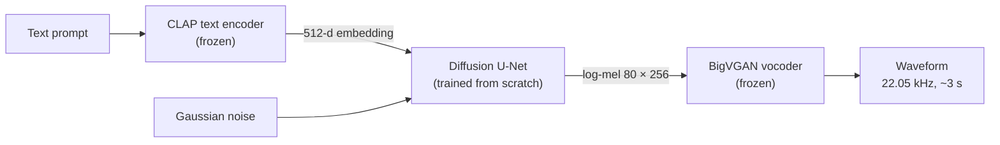

# text-to-sound

**Text-conditioned audio generation with latent diffusion, implemented from scratch in PyTorch.**

Given a natural-language description such as *"rain falling on a tin roof"*, the model generates a ~3-second audio clip. The design follows the latent-diffusion approach of AudioLDM [[1]](#references): a diffusion model generates a mel spectrogram conditioned on a CLAP embedding of the prompt, and a pretrained neural vocoder converts it to a waveform.

The diffusion model, noise schedule, U-Net, training loop and samplers are written from scratch. The pretrained models used are a frozen text/audio encoder (CLAP) and a frozen vocoder (BigVGAN).

> **Status:** in active development. A mel-space baseline generates audio from text prompts; latent diffusion is next. See [Roadmap](#roadmap) and [Results](#results).

---

## Contents

- [Method](#method)
- [Data](#data)
- [Repository structure](#repository-structure)
- [Reproducing](#reproducing)
- [Roadmap](#roadmap)
- [Results](#results)
- [References](#references)
- [License](#license)

---

## Method



| Component | Choice | Notes |
|---|---|---|
| Representation | 80-band log-mel, 22,050 Hz, hop 256 | Matches the vocoder; 65,536 samples → 256 frames |
| Generative model | DDPM [[2]](#references), ε-prediction, linear β schedule (T = 1000) | DDIM sampling [[3]](#references) planned for inference speed |
| Denoiser | U-Net [[4]](#references) with skip connections and sinusoidal timestep embeddings [[5]](#references) | Timestep injected per block as a channel-wise bias |
| Conditioning | CLAP [[6]](#references) embeddings (512-d), shared text/audio space | Trained on audio embeddings, prompted with text embeddings at inference, as in AudioLDM [[1]](#references) |
| Guidance | Classifier-free guidance [[7]](#references) | Condition dropout during training |
| Latent space | Convolutional VAE, mel `1×80×256` → latent `4×20×64` | Planned (Phase 5), following latent diffusion [[8]](#references) |
| Vocoder | BigVGAN v2 [[9]](#references), `nvidia/bigvgan_v2_22khz_80band_256x` | Frozen |

### Training objective

For a clean sample $x_0$, timestep $t \sim \mathcal{U}\{0, \dots, T-1\}$ and noise $\epsilon \sim \mathcal{N}(0, I)$:

$$
x_t = \sqrt{\bar\alpha_t}\, x_0 + \sqrt{1 - \bar\alpha_t}\, \epsilon,
\qquad
\mathcal{L} = \mathbb{E}_{x_0, t, \epsilon}\left[\lVert \epsilon - \epsilon_\theta(x_t, t, c) \rVert^2\right]
$$

where $\bar\alpha_t = \prod_{s \le t}(1 - \beta_s)$ and $c$ is the conditioning embedding.

---

## Data

Training data is built from **Clotho v2.1** [[10]](#references): 3,839 development clips (15–30 s), each with 5 human-written captions.

**Preprocessing** (`clotho-explore.ipynb`):

1. Resample to 22,050 Hz mono; split into non-overlapping 65,536-sample crops (~2.97 s).
2. Discard silent crops (RMS < 0.01).
3. Compute log-mels with the vocoder's own `get_mel_spectrogram` → `[1, 80, 256]`.
4. Normalize to [−1, 1] using dataset-wide min/max (statistics stored for inversion).
5. Compute CLAP audio embeddings per crop (48 kHz) and CLAP text embeddings for each clip's 5 captions.
6. Split train/validation **by source clip** (10% of clips, fixed seed) to prevent leakage between crops of the same recording.

**Result:** 25,469 crops from 3,794 clips (45 fully silent clips dropped), stored as float16.

| File | Shape | Contents |
|---|---|---|
| `mels.npy` | `[N, 1, 80, 256]` float16 | Normalized log-mels |
| `clap_audio.npy` | `[N, 512]` float16 | CLAP audio embedding per crop |
| `clap_text.npy` | `[N, 5, 512]` float16 | CLAP embeddings of the source clip's 5 captions |
| `mel_stats.npy` | `[2]` float32 | Normalization min, max |
| `meta.csv` | `N` rows | `crop_id`, `source`, `split` |

Row *i* of every file refers to the same crop. The dataset is hosted as a private Kaggle dataset (`clotho-mel-clap`).

---

## Repository structure

```
text-to-sound/
├── clotho-explore.ipynb       # Phases 1–2: data exploration, vocoder/CLAP checks, preprocessing
├── ddpm-mnist.ipynb           # Phase 3: DDPM from scratch on MNIST (validation of the diffusion code)
├── text-to-sound-train.ipynb  # Phases 2, 4: dataset round-trip check; mel-space training
├── README.md
└── LICENSE
```

Notebooks are developed on Kaggle and Colab (NVIDIA T4). `text-to-sound-train.ipynb` currently uses Colab paths with data in Google Drive. Stable code will move into `.py` modules in Phase 6.

---

## Reproducing

All notebooks run on Kaggle with a GPU accelerator and internet access enabled.

1. **Data.** Attach the Clotho v2.1 audio archives as input to `clotho-explore.ipynb` and run it with *Save & Run All*. Create a dataset from its output (≈ 25 min on a T4).
2. **Diffusion sanity check.** Run `ddpm-mnist.ipynb` (≈ 30 s per epoch on a T4).
3. **Training.** Attach the dataset from step 1 to `text-to-sound-train.ipynb`.

<details>
<summary>Environment notes</summary>

- BigVGAN's `from_pretrained` is incompatible with recent `huggingface_hub` releases (missing `proxies` / `resume_download` defaults). The notebooks patch `bigvgan.py` with `sed` after cloning.
- With recent `transformers`, `ClapModel.get_*_features` returns an output object; use `.pooler_output`. `ClapProcessor` takes `audio=` rather than `audios=`.
- Importing `bigvgan` switches matplotlib to the `Agg` backend; run `%matplotlib inline` afterwards.
- Extract audio to `/kaggle/temp`, not `/kaggle/working`, to keep raw audio out of notebook outputs.
- Load the dataset arrays into RAM for training. With `mmap_mode`, shuffled reads from Kaggle's input disk were the bottleneck (2.14 s per step).

</details>

---

## Roadmap

| Phase | Description | Status |
|---|---|---|
| 0 | Environment setup (Kaggle, GitHub, Hugging Face) | Done |
| 1 | Data exploration; vocoder round trip; CLAP retrieval check (9/10) | Done |
| 2 | Preprocessing pipeline and dataset | Done |
| 3 | DDPM from scratch on MNIST: training, sampling, class conditioning, CFG | Done |
| 4 | Mel-space diffusion conditioned on CLAP | Done |
| 5 | Mel VAE (`1×80×256` → `4×20×64`) | Planned |
| 6 | Latent diffusion, EMA, DDIM sampling | Planned |
| 7 | Scaling (FSD50K [[11]](#references)) and conditioning ablations | Planned |
| 8 | Evaluation: FAD [[12]](#references), CLAP score, AudioLDM baseline | Planned |
| 9 | Gradio demo on Hugging Face Spaces | Planned |

---

## Results

The mel-space baseline produces audio that follows text prompts for common, texture-like sounds, based on informal listening. No quantitative evaluation has been run yet. Evaluation will report Fréchet Audio Distance [[12]](#references) and CLAP text–audio similarity on the Clotho validation split, with pretrained AudioLDM [[1]](#references) as a reference.

| Experiment | Result |
|---|---|
| Vocoder round trip (BigVGAN, Clotho) | Perceptually near-identical reconstruction |
| CLAP zero-shot retrieval, 10 clips × 10 captions | 9 / 10 correct |
| DDPM on MNIST, 5 epochs, 0.53 M params | Training loss 0.117 → 0.025 |
| Conditional DDPM + CFG on MNIST, 20 epochs, `w = 3` | About 15 / 16 samples clearly "7", 12 / 16 clearly "8" (visual inspection) |
| Mel-space U-Net, 50 epochs, 8.8 M params, `lr` 2e-4 | Training loss 0.116 → 0.018; 2.43 steps/s, 5.34 GB on a T4 |
| Text prompts, mel-space U-Net, `w = 3` | "Rain", "birds" and "people talking" closer to their prompts; "a dog barking" fails (informal listening) |

**Known limitation:** the baseline handles textures better than distinct events. Barking also has little training data: 60 of 3,839 Clotho clips have at least 3 captions mentioning it (keyword count).

---

## References

1. H. Liu et al. **AudioLDM: Text-to-Audio Generation with Latent Diffusion Models.** ICML 2023. [arXiv:2301.12503](https://arxiv.org/abs/2301.12503)
2. J. Ho, A. Jain, P. Abbeel. **Denoising Diffusion Probabilistic Models.** NeurIPS 2020. [arXiv:2006.11239](https://arxiv.org/abs/2006.11239)
3. J. Song, C. Meng, S. Ermon. **Denoising Diffusion Implicit Models.** ICLR 2021. [arXiv:2010.02502](https://arxiv.org/abs/2010.02502)
4. O. Ronneberger, P. Fischer, T. Brox. **U-Net: Convolutional Networks for Biomedical Image Segmentation.** MICCAI 2015. [arXiv:1505.04597](https://arxiv.org/abs/1505.04597)
5. A. Vaswani et al. **Attention Is All You Need.** NeurIPS 2017. [arXiv:1706.03762](https://arxiv.org/abs/1706.03762)
6. Y. Wu et al. **Large-Scale Contrastive Language-Audio Pretraining with Feature Fusion and Keyword-to-Caption Augmentation.** ICASSP 2023. [arXiv:2211.06687](https://arxiv.org/abs/2211.06687)
7. J. Ho, T. Salimans. **Classifier-Free Diffusion Guidance.** NeurIPS 2021 Workshop. [arXiv:2207.12598](https://arxiv.org/abs/2207.12598)
8. R. Rombach et al. **High-Resolution Image Synthesis with Latent Diffusion Models.** CVPR 2022. [arXiv:2112.10752](https://arxiv.org/abs/2112.10752)
9. S. Lee et al. **BigVGAN: A Universal Neural Vocoder with Large-Scale Training.** ICLR 2023. [arXiv:2206.04658](https://arxiv.org/abs/2206.04658)
10. K. Drossos, S. Lipping, T. Virtanen. **Clotho: An Audio Captioning Dataset.** ICASSP 2020. [arXiv:1910.09387](https://arxiv.org/abs/1910.09387)
11. E. Fonseca et al. **FSD50K: An Open Dataset of Human-Labeled Sound Events.** IEEE/ACM TASLP 2022. [arXiv:2010.00475](https://arxiv.org/abs/2010.00475)
12. K. Kilgour et al. **Fréchet Audio Distance: A Metric for Evaluating Music Enhancement Algorithms.** Interspeech 2019. [arXiv:1812.08466](https://arxiv.org/abs/1812.08466)

---

## License

Code is released under the [MIT License](LICENSE). Clotho, CLAP and BigVGAN are subject to their own licenses.
