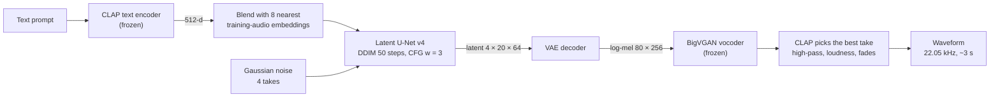

# text-to-sound

**Text-conditioned audio generation with latent diffusion, implemented from scratch in PyTorch.**

Given a natural-language description such as *"rain falling on a tin roof"*, the model generates a ~3-second audio clip. The design follows the latent-diffusion approach of AudioLDM [[1]](#references): a diffusion model generates a compressed mel-spectrogram latent conditioned on a CLAP embedding of the prompt, a VAE decodes it to a mel spectrogram, and a pretrained neural vocoder converts that to a waveform.

The VAE, diffusion model, noise schedules, U-Nets, training loops and samplers are written from scratch. The pretrained models used are a frozen text/audio encoder (CLAP) and a frozen vocoder (BigVGAN).

**Live demo:** [abrandonwang.github.io/text-to-sound](https://abrandonwang.github.io/text-to-sound/). Type a sound and watch the model generate it step by step.

> **Status:** a 67.5 M-parameter latent diffusion U-Net (v4), trained on Clotho and FSD50K, is live behind the demo. Mean CLAP text–audio score is 0.415 per take and 0.474 for the best of 4. Next: Fréchet Audio Distance and an AudioLDM baseline. See [Roadmap](#roadmap) and [Results](#results).

---

## Contents

- [Method](#method)
- [Data](#data)
- [Repository structure](#repository-structure)
- [Reproducing](#reproducing)
- [Roadmap](#roadmap)
- [Results](#results)
- [References](#references)
- [License](#license)

---

## Method



| Component | Choice | Notes |
|---|---|---|
| Representation | 80-band log-mel, 22,050 Hz, hop 256 | Matches the vocoder; 65,536 samples → 256 frames |
| Latent space | Convolutional VAE, mel `1×80×256` → latent `4×20×64` (2.3 M params) | L1 + KL, then decoder fine-tuned with a PatchGAN discriminator [[13]](#references) (encoder frozen), following latent diffusion [[8]](#references). Latents scaled to unit std (scale 0.554 on Clotho + FSD50K) |
| Generative model | DDPM [[2]](#references), ε-prediction, T = 1000, scaled-linear β schedule (√β linear from 0.0015 to 0.0195, as in LDM/AudioLDM) | Earlier models used DDPM's linear schedule (1e-4 to 0.02) |
| Denoiser | U-Net v4, ADM-style [[14]](#references): 128 base channels, ×1/×2/×4, 2 ResBlocks per level, self-attention (32 channels per head) at the two lower resolutions and the middle | Timestep and CLAP each pass through a 2-layer MLP and modulate every ResBlock with FiLM [[15]](#references) scale and shift. Last conv of each block zero-initialized. 67.5 M params |
| Conditioning | CLAP [[6]](#references) embeddings (512-d) | Trained on a 50/50 mix of the crop's CLAP audio embedding and one of its 5 caption embeddings |
| Guidance | Classifier-free guidance [[7]](#references), w = 3 | 10% condition dropout during training |
| Sampling | DDIM [[3]](#references), 50 steps, η = 0 | 4 takes per request, batched with the unconditional pass |
| Retrieval conditioning | Prompt embedding + 2 × mean of its 8 nearest CLAP *audio* embeddings from the training set, renormalized | Bridges the gap between CLAP's text and audio embeddings (paired cosine ≈ 0.40); the model follows audio embeddings better |
| Reranking | CLAP text–audio cosine picks the best of 4 takes; takes below −45 dB are pushed to the back | |
| Output | 40 Hz high-pass, RMS normalized to −20 dBFS (max +30 dB gain, peak 0.97), 12 ms fades | Raw takes ranged from −48 dB to clipped, with DC offsets up to 0.1 |
| Vocoder | BigVGAN v2 [[9]](#references), `nvidia/bigvgan_v2_22khz_80band_256x` | Frozen |

### Training objective

For a clean latent $z_0$, timestep $t \sim \mathcal{U}\{0, \dots, T-1\}$ and noise $\epsilon \sim \mathcal{N}(0, I)$:

$$
z_t = \sqrt{\bar\alpha_t}\, z_0 + \sqrt{1 - \bar\alpha_t}\, \epsilon,
\qquad
\mathcal{L} = \mathbb{E}_{z_0, t, \epsilon}\left[\lVert \epsilon - \epsilon_\theta(z_t, t, c) \rVert^2\right]
$$

where $\bar\alpha_t = \prod_{s \le t}(1 - \beta_s)$ and $c$ is the conditioning embedding (zeroed 10% of the time for classifier-free guidance).

**U-Net v4 training** (`latent_diffusion.ipynb`): AdamW, learning rate 1e-4 with 2,000 warm-up steps, batch 64, 40 epochs, gradient clipping at 1.0, bf16 autocast where supported, EMA of the weights with decay 0.9999. The EMA weights are what the server loads.

---

## Data

### Clotho

**Clotho v2.1** [[10]](#references): 3,839 development clips (15–30 s), each with 5 human-written captions.

**Preprocessing** (`clotho-explore.ipynb`):

1. Resample to 22,050 Hz mono; split into non-overlapping 65,536-sample crops (~2.97 s).
2. Discard silent crops (RMS < 0.01).
3. Compute log-mels with the vocoder's own `get_mel_spectrogram` → `[1, 80, 256]`.
4. Normalize to [−1, 1] using dataset-wide min/max (statistics stored for inversion).
5. Compute CLAP audio embeddings per crop (48 kHz) and CLAP text embeddings for each clip's 5 captions.
6. Split train/validation **by source clip** (10% of clips, fixed seed) to prevent leakage between crops of the same recording.

**Result:** 25,469 crops from 3,794 clips (45 fully silent clips dropped), 22,848 of them in the training split, stored as float16.

| File | Shape | Contents |
|---|---|---|
| `mels.npy` | `[N, 1, 80, 256]` float16 | Normalized log-mels |
| `clap_audio.npy` | `[N, 512]` float16 | CLAP audio embedding per crop |
| `clap_text.npy` | `[N, 5, 512]` float16 | CLAP embeddings of the source clip's 5 captions |
| `mel_stats.npy` | `[2]` float32 | Normalization min, max |
| `meta.csv` | `N` rows | `crop_id`, `source`, `split` |
| `latents.npy` | `[N, 4, 20, 64]` float16 | VAE encoder means (from `mel_vae.ipynb`) |

Row *i* of every file refers to the same crop.

### FSD50K

**FSD50K** [[11]](#references) development set: 40,966 clips labelled with 200 sound-event classes. It adds instruments, household and mechanical sounds that Clotho barely covers.

**Preprocessing** (`fsd50k_prep.ipynb`):

1. Up to 3 non-silent 65,536-sample crops per clip; clips shorter than one crop are zero-padded.
2. Log-mel → VAE encoder mean → latent `4×20×64`, with the same normalization as Clotho.
3. CLAP audio embedding per crop; 5 captions per clip built from its labels (the full label list, the first label, "the sound of …", "a recording of … and …", "… sound") and embedded with CLAP.
4. Stored in shards of 2,000 clips: `fsd/shard_*.npz` with `latents`, `clap_audio`, `clap_text`, `fname`.

At training time, the silent padding of short clips is removed by tiling their real-sound columns to the full 64; clips with fewer than 4 columns of sound are dropped.

Data and checkpoints live in Google Drive (`MyDrive/text-to-sound/data/` and `checkpoints/`).

---

## Repository structure

```
text-to-sound/
├── clotho-explore.ipynb       # Phases 1–2: data exploration, vocoder/CLAP checks, Clotho preprocessing
├── ddpm-mnist.ipynb           # Phase 3: DDPM from scratch on MNIST (validation of the diffusion code)
├── text-to-sound-train.ipynb  # Phases 2, 4: dataset round-trip check; mel-space baseline
├── mel_vae.ipynb              # Phase 5: mel VAE, PatchGAN fine-tune, Clotho latents
├── fsd50k_prep.ipynb          # Phase 7: FSD50K crops → latents + CLAP embeddings
├── latent_diffusion.ipynb     # Phases 6–7: latent U-Nets v3 and v4, EMA, DDIM + CFG sampling
├── server/                    # Model server (FastAPI, SSE), Modal deploy, eval scripts
├── web/                       # Showcase site (React) and its mock backend
├── .github/workflows/         # GitHub Pages deploy for web/frontend
├── README.md
└── LICENSE
```

Training notebooks run on Colab (NVIDIA T4), with data and checkpoints in Google Drive. `clotho-explore.ipynb` and `ddpm-mnist.ipynb` were developed on Kaggle and keep Kaggle paths. The model classes used for inference are copied into [`server/model.py`](server/model.py).

---

## Reproducing

1. **Clotho data.** Attach the Clotho v2.1 audio archives to `clotho-explore.ipynb` on Kaggle and run it with *Save & Run All* (≈ 25 min on a T4). Copy the output arrays to the Drive `data/` folder.
2. **Diffusion sanity check.** Run `ddpm-mnist.ipynb` (≈ 30 s per epoch on a T4).
3. **Mel-space baseline** (optional). `text-to-sound-train.ipynb`.
4. **VAE.** `mel_vae.ipynb` trains the VAE, fine-tunes the decoder against the discriminator (`vae_gan2.pt`) and writes `latents.npy`.
5. **FSD50K.** `fsd50k_prep.ipynb` downloads FSD50K and writes the shards to `data/fsd/`. `END` sets how many clips it processes.
6. **Latent diffusion.** `latent_diffusion.ipynb` trains U-Net v4 and writes `unet_v4_ema.pt` plus `unet_v4_ema_config.json` (architecture, latent scale and noise schedule). It resumes from the last saved epoch after a Colab disconnect.
7. **Serve and evaluate.** See [`server/README.md`](server/README.md): build the retrieval bank, run `eval.py`, deploy to Modal.

<details>
<summary>Environment notes</summary>

- BigVGAN's `from_pretrained` is incompatible with recent `huggingface_hub` releases (missing `proxies` / `resume_download` defaults). The notebooks patch `bigvgan.py` with `sed` after cloning; `server/app.py` patches it the same way.
- With recent `transformers`, `ClapModel.get_*_features` returns an output object; use `.pooler_output`. `ClapProcessor` takes `audio=` rather than `audios=`.
- Importing `bigvgan` switches matplotlib to the `Agg` backend; run `%matplotlib inline` afterwards.
- Extract audio to `/kaggle/temp`, not `/kaggle/working`, to keep raw audio out of notebook outputs.
- Load the dataset arrays into RAM for training. With `mmap_mode`, shuffled reads from Kaggle's input disk were the bottleneck (2.14 s per step).
- Inference runs on an Apple-silicon Mac with `DEVICE=mps`: about 17 ms per U-Net sample-step and 1.6 s per clip for BigVGAN, so ~15 s per prompt at 4 takes. With torch 2.15, BigVGAN on MPS output near-silence while torch 2.12 was fine; if takes come out silent locally, run the vocoder on CPU.

</details>

---

## Roadmap

| Phase | Description | Status |
|---|---|---|
| 0 | Environment setup (Kaggle, Colab, GitHub, Hugging Face) | Done |
| 1 | Data exploration; vocoder round trip; CLAP retrieval check (9/10) | Done |
| 2 | Preprocessing pipeline and dataset | Done |
| 3 | DDPM from scratch on MNIST: training, sampling, class conditioning, CFG | Done |
| 4 | Mel-space diffusion conditioned on CLAP | Done |
| 5 | Mel VAE (`1×80×256` → `4×20×64`) | Done |
| 6 | Latent diffusion, EMA, DDIM sampling | Done |
| 7 | Scaling and conditioning: FSD50K data, U-Net v4, retrieval conditioning, best-of-n reranking | Mostly done: the retrieval bank is still Clotho-only |
| 8 | Evaluation: CLAP score, FAD [[12]](#references), AudioLDM baseline | In progress: CLAP score done |
| 9 | Showcase website connected to the model ([live](https://abrandonwang.github.io/text-to-sound/)) | Done |

**Next:**

- Fréchet Audio Distance on the Clotho validation split, with pretrained AudioLDM [[1]](#references) as a reference.
- Rebuild the retrieval bank with FSD50K embeddings (`server/make_bank.py` on the Drive data folder).
- Improve drums and speech, which fail under every sampling setting tried; this needs training-side changes.

---

## Results

**CLAP score** is the cosine similarity between the CLAP audio embedding of a generated clip and the CLAP text embedding of the raw prompt. It is measured by [`server/eval.py`](server/eval.py) on 24 fixed prompts. Because the same CLAP model also picks the best take, best-of-4 numbers flatter the model; FAD will be the independent check.

| Setup | Mean per take | Best of 4 |
|---|---|---|
| Latent U-Net v3 (9.7 M params, linear β), text embedding | 0.194 | 0.299 |
| Latent U-Net v4 (67.5 M params, scaled-linear β), text embedding | 0.332 | 0.409 |
| **U-Net v4 + retrieval conditioning (live)** | **0.415** | **0.474** |

The first two rows come from a separate scratch harness with slightly different seeding; the last is `server/eval.py`. In a paired comparison (20 prompts × 3 seeds), retrieval conditioning alone raised the mean from 0.328 to 0.387. It helped the weakest prompts most: "people talking" −0.05 → 0.19, "birds singing" 0.13 → 0.28.

**Sampler and guidance sweep** (U-Net v4, text embedding, 20 prompts × 3 seeds, mean CLAP):

| Setting | CLAP | Note |
|---|---|---|
| DDIM 50, w = 3 (default) | 0.328 | |
| w = 2 | 0.276 | |
| w = 4 | 0.342 | Latent std 1.09 |
| w = 5 | 0.352 | Oversaturates: latent std 1.23, DC offset 0.26 |
| DDIM 100 | 0.345 | 2× the denoising time |
| DPM-Solver++ 50 | 0.339 | |
| DPM-Solver++ 25 | 0.309 | |
| "the sound of {prompt}" template | 0.301 | |
| Blend with nearest training *captions* | 0.316 | Audio embeddings work, captions don't |

Guidance stays at 3: higher scored slightly better but oversaturated the latents, and the retrieval blend gave a larger gain cleanly.

**Demo prompts.** All 198 prompts the site can suggest were scored ([`server/good_prompts.json`](server/good_prompts.json), best of 4, one seed). Median CLAP 0.51. Strongest: "flute" 0.78, "frog" 0.74, "boiling" 0.73, "sigh" 0.73, "sneeze" 0.71, "glass breaking" 0.70. The 19 below 0.3 are mostly drums ("snare drum" 0.01, "drum kit" 0.08) and speech ("conversation" 0.16, "man speaking" 0.17); the site's `/suggest` leaves them out.

**Earlier experiments**

| Experiment | Result |
|---|---|
| Vocoder round trip (BigVGAN, Clotho) | Perceptually near-identical reconstruction |
| CLAP zero-shot retrieval, 10 clips × 10 captions | 9 / 10 correct |
| DDPM on MNIST, 5 epochs, 0.53 M params | Training loss 0.117 → 0.025 |
| Conditional DDPM + CFG on MNIST, 20 epochs, `w = 3` | About 15 / 16 samples clearly "7", 12 / 16 clearly "8" (visual inspection) |
| Mel-space U-Net, 50 epochs, 8.8 M params, `lr` 2e-4 | Training loss 0.116 → 0.018; 2.43 steps/s, 5.34 GB on a T4 |
| Text prompts, mel-space U-Net, `w = 3` | "Rain", "birds" and "people talking" closer to their prompts; "a dog barking" fails (informal listening) |
| Mel VAE, 12 epochs, L1 + 1e-5·KL | Validation L1 0.024 (4 crops); reconstructions keep structure but have a low static (smoothed noise texture) |
| Mel VAE + PatchGAN decoder fine-tune, 5 epochs | Validation L1 0.031 (4 crops), but reconstructions sound near-identical to the originals (informal listening) |
| Clotho latents | 25,469 × `4×20×64`, std 1.46, scale factor 0.686 |

"A dog barking", which failed in the mel-space baseline, now scores 0.535 with v4 (best of 4).

**Known limitations:** drums and speech fail regardless of sampling settings. The retrieval bank only covers Clotho, so FSD50K-style label prompts (instruments especially) get less help from it. No FAD or baseline comparison yet.

---

## References

1. H. Liu et al. **AudioLDM: Text-to-Audio Generation with Latent Diffusion Models.** ICML 2023. [arXiv:2301.12503](https://arxiv.org/abs/2301.12503)
2. J. Ho, A. Jain, P. Abbeel. **Denoising Diffusion Probabilistic Models.** NeurIPS 2020. [arXiv:2006.11239](https://arxiv.org/abs/2006.11239)
3. J. Song, C. Meng, S. Ermon. **Denoising Diffusion Implicit Models.** ICLR 2021. [arXiv:2010.02502](https://arxiv.org/abs/2010.02502)
4. O. Ronneberger, P. Fischer, T. Brox. **U-Net: Convolutional Networks for Biomedical Image Segmentation.** MICCAI 2015. [arXiv:1505.04597](https://arxiv.org/abs/1505.04597)
5. A. Vaswani et al. **Attention Is All You Need.** NeurIPS 2017. [arXiv:1706.03762](https://arxiv.org/abs/1706.03762)
6. Y. Wu et al. **Large-Scale Contrastive Language-Audio Pretraining with Feature Fusion and Keyword-to-Caption Augmentation.** ICASSP 2023. [arXiv:2211.06687](https://arxiv.org/abs/2211.06687)
7. J. Ho, T. Salimans. **Classifier-Free Diffusion Guidance.** NeurIPS 2021 Workshop. [arXiv:2207.12598](https://arxiv.org/abs/2207.12598)
8. R. Rombach et al. **High-Resolution Image Synthesis with Latent Diffusion Models.** CVPR 2022. [arXiv:2112.10752](https://arxiv.org/abs/2112.10752)
9. S. Lee et al. **BigVGAN: A Universal Neural Vocoder with Large-Scale Training.** ICLR 2023. [arXiv:2206.04658](https://arxiv.org/abs/2206.04658)
10. K. Drossos, S. Lipping, T. Virtanen. **Clotho: An Audio Captioning Dataset.** ICASSP 2020. [arXiv:1910.09387](https://arxiv.org/abs/1910.09387)
11. E. Fonseca et al. **FSD50K: An Open Dataset of Human-Labeled Sound Events.** IEEE/ACM TASLP 2022. [arXiv:2010.00475](https://arxiv.org/abs/2010.00475)
12. K. Kilgour et al. **Fréchet Audio Distance: A Metric for Evaluating Music Enhancement Algorithms.** Interspeech 2019. [arXiv:1812.08466](https://arxiv.org/abs/1812.08466)
13. P. Isola, J.-Y. Zhu, T. Zhou, A. A. Efros. **Image-to-Image Translation with Conditional Adversarial Networks.** CVPR 2017. [arXiv:1611.07004](https://arxiv.org/abs/1611.07004)
14. P. Dhariwal, A. Nichol. **Diffusion Models Beat GANs on Image Synthesis.** NeurIPS 2021. [arXiv:2105.05233](https://arxiv.org/abs/2105.05233)
15. E. Perez et al. **FiLM: Visual Reasoning with a General Conditioning Layer.** AAAI 2018. [arXiv:1709.07871](https://arxiv.org/abs/1709.07871)

---

## License

Code is released under the [MIT License](LICENSE). Clotho, FSD50K, CLAP and BigVGAN are subject to their own licenses.
